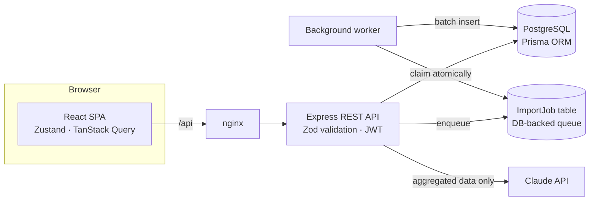

# FinSight — B2B Financial Analytics


FinSight is a fullstack web application for small and mid-sized B2B companies: it tracks revenue and
expenses, builds management reports (P&L by month, cost structure), imports bank/accounting CSV
exports in the background and generates **AI insights** about the business with an LLM.

**Stack:** React 18 · TypeScript · Zustand · TanStack Query · Recharts · Node.js · Express · Zod ·
PostgreSQL · Prisma ORM · Jest · Supertest · Playwright · Docker · GitHub Actions · Anthropic Claude API

---

## Features

| Area | What it does |
| --- | --- |
| **Dashboard** | Revenue, expenses, net profit, margin, month-over-month change; revenue vs. expenses chart; expense structure by category; period filter (3/6/12 months, all time) |
| **Transactions** | Paginated, filterable history; add/delete transactions; categories autocomplete |
| **CSV import** | Upload a CSV → a job is queued → a background worker parses and inserts it in batches → the UI polls progress and shows row-level errors |
| **AI insights** | Aggregated financials are sent to an LLM, which returns structured insights (validated with Zod). Without an API key or on LLM failure, a deterministic rule engine produces insights instead |
| **Auth** | Registration/login with bcrypt-hashed passwords and JWT; every query is scoped to the current user |

## Architecture



```
apps/
├── api/                      # Node.js + Express + Prisma
│   ├── prisma/               # schema, SQL migrations, demo seed
│   ├── src/
│   │   ├── domain/           # pure business logic (analytics, CSV parser, insights), covered by unit tests
│   │   ├── modules/          # feature modules: auth, transactions, analytics, imports, insights
│   │   ├── middleware/       # JWT auth, centralized error handling
│   │   ├── worker/           # background import worker
│   │   └── lib/              # Prisma client, LLM client, HTTP helpers
│   └── tests/                # Jest unit + HTTP tests (Supertest)
└── web/                      # React + Vite
    ├── src/api/              # typed fetch client + TanStack Query hooks
    ├── src/store/            # Zustand stores (auth session, period filter)
    ├── src/components/ · src/pages/
    └── e2e/                  # Playwright end-to-end tests
```

### Key engineering decisions

- **Money as integer cents.** Amounts are stored as `INTEGER` cents and parsed from strings without
  floating-point math (`"10.05"` → `1005`), so totals never drift.
- **Aggregation in the database.** The dashboard runs a single `GROUP BY month, type, category` query
  using the `(userId, date)` index. The API transfers *months × categories* rows instead of every
  transaction, and pure functions turn them into KPIs — easy to test, cheap at any data volume.
- **DB-backed job queue.** Imports are stored as `ImportJob` rows. The worker claims a job with an
  atomic conditional update (`PENDING → PROCESSING`), so multiple worker instances can run safely;
  rows are inserted with `createMany` in batches of 500 and progress is reported to the UI.
- **LLM with a safety net.** Only aggregated numbers (no raw transactions or personal data) are sent
  to the model. The response must be a JSON array that passes a Zod schema; otherwise the rule-based
  engine answers. The LLM client takes an injectable `fetch`, so it is unit-tested without network.
- **Validation at the edge.** Every request body and query string is validated with Zod; errors come
  back as structured `400` responses. Data access is always scoped by `userId`.
- **Server state vs. client state.** TanStack Query owns server data (caching, invalidation after
  mutations, polling of import jobs); Zustand holds only client state (session, selected period).

## Getting started

### Option 1 — Docker (recommended)

```bash
docker compose up --build
```

- App: http://localhost:8080 — demo login **demo@finsight.dev / demo12345** (12 months of sample data)
- API: http://localhost:4000/health

To enable LLM insights, export a key before starting: `export ANTHROPIC_API_KEY=sk-ant-...`

### Option 2 — Local development

```bash
# 1. Database
docker compose up -d db

# 2. API
cd apps/api
cp .env.example .env
npm install
npx prisma migrate deploy
npm run db:seed
npm run dev            # http://localhost:4000

# 3. Web (new terminal)
cd apps/web
npm install
npm run dev            # http://localhost:5173 (proxies /api to :4000)
```

## Testing

```bash
cd apps/api && npm test              # unit + HTTP tests (no database required)
cd apps/api && npm run test:coverage # with coverage report
cd apps/web && npm run e2e           # Playwright, against the running Docker stack
```

CI (GitHub Actions) runs type checks, unit tests with coverage, production builds and the Playwright
suite against the full Docker Compose stack on every push.

## REST API

All endpoints except `/api/auth/*` require `Authorization: Bearer <token>`.

| Method | Endpoint | Description |
| --- | --- | --- |
| POST | `/api/auth/register` | `{ email, password, name }` → `{ token, user }` |
| POST | `/api/auth/login` | `{ email, password }` → `{ token, user }` |
| GET | `/api/auth/me` | Current user |
| GET | `/api/transactions` | `?from&to&type&category&page&pageSize` → paginated list |
| POST | `/api/transactions` | `{ date, amount, type, category, description? }` |
| DELETE | `/api/transactions/:id` | Delete own transaction |
| GET | `/api/transactions/categories` | Distinct categories |
| GET | `/api/analytics/summary` | `?from&to` → KPIs, monthly series, expense structure |
| POST | `/api/imports` | `{ csv }` → `202 Accepted` with a job |
| GET | `/api/imports/:id` | Job status, progress and row errors |
| POST | `/api/insights` | `{ from?, to? }` → `{ source: "llm" \| "rules", insights[] }` |

CSV format:

```csv
date,amount,type,category,description
2026-09-02,12500.00,INCOME,Subscriptions,"Client A, annual plan"
2026-09-05,1840.50,EXPENSE,Cloud,GCP invoice
```

## Roadmap

- Multi-currency with exchange-rate snapshots
- Organizations and role-based access for teams
- Budgets and forecasting (plan vs. actual)
- Deploy to Google Cloud Run + Cloud SQL

## License

MIT
